# Bug drafts — G1 (Chrome run)

42 bug, gom từ 51 item Failed theo root cause.

| # | Title | Severity | Priority | Module | Checklist |
|---|---|---|---|---|---|
| 1 | [BUG][login] Login page heading shows "Đăng Ký" instead of "Đăng nhập" | minor | P2 | login | IA-01-03 |
| 2 | [BUG][login] English labels "Username" and "Sign In" on Vietnamese Login form | minor | P3 | login | IA-01-01, IA-01-02 |
| 3 | [BUG][login] Login password field displays the password in plain text | major | P1 | login | IA-02-04 |
| 4 | [BUG][ui] Email fields use type="text" so malformed emails are not validated | minor | P2 | ui | IA-02-03 |
| 5 | [BUG][register] Register submit button is red instead of the positive-action blue | trivial | P3 | register | IA-01-04 |
| 6 | [BUG][forgot-password] Reset and Back buttons on step 2 share the same green style | trivial | P3 | forgot-password | IA-01-05 |
| 7 | [BUG][ui] No page has an <h1> heading | minor | P3 | ui | IA-01-06 |
| 8 | [BUG][register] Password rule hint has insufficient contrast (2.54:1) | minor | P3 | register | IA-01-08 |
| 9 | [BUG][login] Sign In button has tabIndex=1 and is focused before the form fields | minor | P2 | login | IA-01-14 |
| 10 | [BUG][profile] Header greeting is not updated after saving a new name | minor | P2 | profile | IA-04-20, IA-01-18 |
| 11 | [BUG][navigation] User name is rendered as HTML in the header greeting (stored XSS) | critical | P0 | navigation | IA-01-20 |
| 12 | [BUG][ui] Required fields have no * marker | trivial | P3 | ui | IA-02-01 |
| 13 | [BUG][ui] Form labels are not associated with their inputs | minor | P3 | ui | IA-02-02 |
| 14 | [BUG][register] Register form has no Confirm Password field | major | P1 | register | IA-02-05 |
| 15 | [BUG][register] Password validator requires a space and rejects special characters, contradicting its own message | critical | P0 | register | IA-02-06, IA-04-05 |
| 16 | [BUG][register] Duplicate email is accepted, including case/space variants | critical | P1 | register | IA-02-07, IA-04-06, IA-02-19 |
| 17 | [BUG][login] Login error banner is shown below the submit button | trivial | P3 | login | IA-02-08 |
| 18 | [BUG][forgot-password] Forgot Password has no step indicator | minor | P2 | forgot-password | IA-02-09, IA-02-11 |
| 19 | [BUG][forgot-password] OTP has only 4 digits and the OTP input has no length validation | major | P1 | forgot-password | IA-02-12 |
| 20 | [BUG][forgot-password] Reset form has no Confirm New Password field | major | P2 | forgot-password | IA-02-13 |
| 21 | [BUG][ui] Feedback uses blocking alert() instead of inline messages | minor | P2 | ui | IA-02-14, IA-04-11 |
| 22 | [BUG][forgot-password] Unknown email reveals "User not found" (account enumeration) | major | P2 | forgot-password | IA-04-07 |
| 23 | [BUG][profile] Valid phone numbers starting with 0 are rejected | major | P1 | profile | IA-02-15, IA-04-12 |
| 24 | [BUG][ui] Email/password fields have no autocomplete attributes | trivial | P3 | ui | IA-02-18 |
| 25 | [BUG][forgot-password] New-password rule is not shown on reset step 2 | minor | P3 | forgot-password | IA-02-20 |
| 26 | [BUG][forgot-password] Pasted OTP with surrounding spaces is rejected | minor | P2 | forgot-password | IA-02-21 |
| 27 | [BUG][profile] Long email is cut off in the read-only Profile field | trivial | P3 | profile | IA-02-22 |
| 28 | [BUG][navigation] Navbar does not highlight the current page | trivial | P3 | navigation | IA-03-03 |
| 29 | [BUG][navigation] Cart link has no item-count badge | minor | P2 | navigation | IA-03-04 |
| 30 | [BUG][navigation] Logout button is labelled "Thoát" instead of "Đăng xuất" | trivial | P3 | navigation | IA-03-05 |
| 31 | [BUG][login] "Quên mật khẩu?" link triggers a full page reload | trivial | P3 | login | IA-03-07 |
| 32 | [BUG][forgot-password] Step 1 has no "Quay lại đăng nhập" button | minor | P2 | forgot-password | IA-03-10 |
| 33 | [BUG][forgot-password] Refreshing step 2 loses the reset progress | minor | P3 | forgot-password | IA-03-12 |
| 34 | [BUG][profile] Logged-out /profile shows a dead-end message instead of redirecting | minor | P3 | profile | IA-03-16 |
| 35 | [BUG][navigation] Logged-in users can still open /login and /register | minor | P3 | navigation | IA-03-17, IA-03-18 |
| 36 | [BUG][login] Locked account shows the same generic error as a wrong password | major | P2 | login | IA-04-02 |
| 37 | [BUG][login] Old login error stays visible after editing the fields | trivial | P3 | login | IA-04-03 |
| 38 | [BUG][register] No success message after a successful registration | minor | P3 | register | IA-04-04 |
| 39 | [BUG][profile] Empty order history has no icon/illustration | trivial | P3 | profile | IA-04-13 |
| 40 | [BUG][ui] Submit buttons have no loading state and allow duplicate requests | major | P2 | ui | IA-04-16 |
| 41 | [BUG][ui] Feedback messages are not exposed to assistive technology | minor | P3 | ui | IA-04-17 |
| 42 | [BUG][ui] Server failure messages are inconsistent and raw | minor | P3 | ui | IA-04-18 |

---
### 1. [BUG][login] Login page heading shows "Đăng Ký" instead of "Đăng nhập"
Labels: type: bug, severity: minor, priority: P2, status: new, module: login

## Mô tả lỗi
Login page heading shows "Đăng Ký" instead of "Đăng nhập"

## Môi trường
- OS: Ubuntu 26.04.1 LTS · Browser: Google Chrome 155.0.8059.84 (Playwright 1.64.1, headed)
- SUT: EShop `eshop-sut` commit `85af3ba` · Web http://localhost:5173 · API http://localhost:3000
- Test account: tài khoản tạo mới cho từng test qua `POST /api/register`; seed `test@eshop.com` / `Test1234!`

## Steps to reproduce
1. Mở http://localhost:5173/login

## Actual result
Heading của trang Login là "Đăng Ký".

## Expected result
Heading mô tả đúng trang: "Đăng nhập".

## Evidence
**IA-01-03**

## Traceability
- Checklist item: IA-01-03 (`checklist/gui-checklist.xlsx`)
- Requirement: FR-21

---
### 2. [BUG][login] English labels "Username" and "Sign In" on Vietnamese Login form
Labels: type: bug, severity: minor, priority: P3, status: new, module: login

## Mô tả lỗi
English labels "Username" and "Sign In" on Vietnamese Login form

## Môi trường
- OS: Ubuntu 26.04.1 LTS · Browser: Google Chrome 155.0.8059.84 (Playwright 1.64.1, headed)
- SUT: EShop `eshop-sut` commit `85af3ba` · Web http://localhost:5173 · API http://localhost:3000
- Test account: tài khoản tạo mới cho từng test qua `POST /api/register`; seed `test@eshop.com` / `Test1234!`

## Steps to reproduce
1. Mở http://localhost:5173/login
2. Quan sát nhãn field đầu tiên và nút submit

## Actual result
Nhãn là "Username", nút là "Sign In" (tiếng Anh) giữa giao diện tiếng Việt.

## Expected result
Nhãn "Email", nút "Đăng nhập", nhất quán tiếng Việt.

## Evidence
**IA-01-01**

**IA-01-02**

## Traceability
- Checklist item: IA-01-01, IA-01-02 (`checklist/gui-checklist.xlsx`)
- Requirement: FR-21

---
### 3. [BUG][login] Login password field displays the password in plain text
Labels: type: bug, severity: major, priority: P1, status: new, module: login

## Mô tả lỗi
Login password field displays the password in plain text

## Môi trường
- OS: Ubuntu 26.04.1 LTS · Browser: Google Chrome 155.0.8059.84 (Playwright 1.64.1, headed)
- SUT: EShop `eshop-sut` commit `85af3ba` · Web http://localhost:5173 · API http://localhost:3000
- Test account: tài khoản tạo mới cho từng test qua `POST /api/register`; seed `test@eshop.com` / `Test1234!`

## Steps to reproduce
1. Mở http://localhost:5173/login
2. Gõ bất kỳ password nào vào field "Mật khẩu"

## Actual result
Password hiện rõ ký tự; field có `type="text"`.

## Expected result
Field dùng `type="password"`, ký tự bị che.

## Evidence
**IA-02-04**

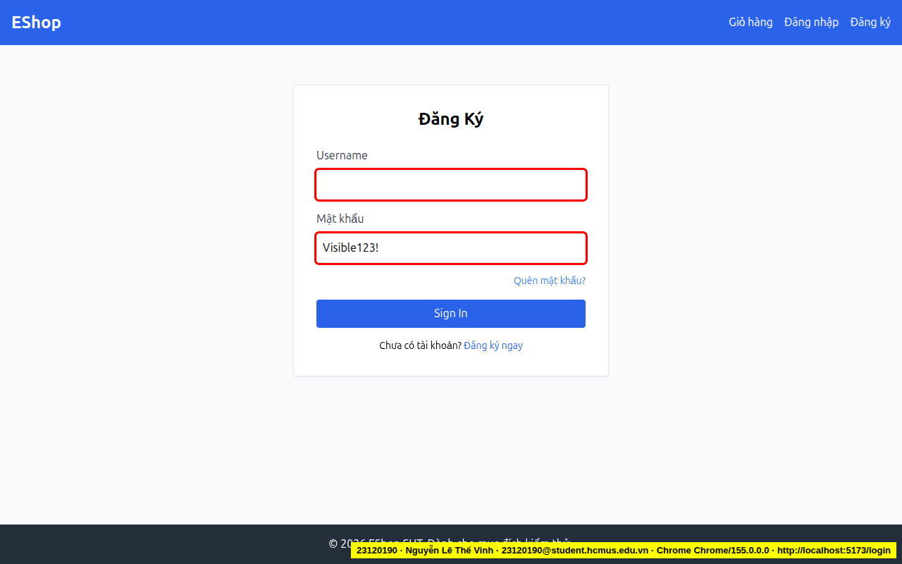

## Traceability
- Checklist item: IA-02-04 (`checklist/gui-checklist.xlsx`)
- Requirement: FR-22

---
### 4. [BUG][ui] Email fields use type="text" so malformed emails are not validated
Labels: type: bug, severity: minor, priority: P2, status: new, module: ui

## Mô tả lỗi
Email fields use type="text" so malformed emails are not validated

## Môi trường
- OS: Ubuntu 26.04.1 LTS · Browser: Google Chrome 155.0.8059.84 (Playwright 1.64.1, headed)
- SUT: EShop `eshop-sut` commit `85af3ba` · Web http://localhost:5173 · API http://localhost:3000
- Test account: tài khoản tạo mới cho từng test qua `POST /api/register`; seed `test@eshop.com` / `Test1234!`

## Steps to reproduce
1. Mở http://localhost:5173/login (tương tự /register, /forgot-password)
2. Nhập email `abc` và submit

## Actual result
Field email là `type="text"`; `abc` được gửi lên server, không có validation HTML5.

## Expected result
Field dùng `type="email"`; trình duyệt chặn `abc` và không gửi request.

## Evidence
**IA-02-03**

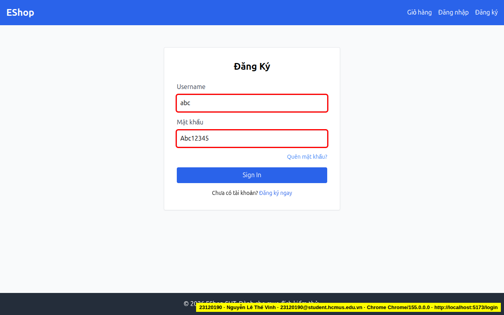

## Traceability
- Checklist item: IA-02-03 (`checklist/gui-checklist.xlsx`)
- Requirement: FR-02, FR-22

---
### 5. [BUG][register] Register submit button is red instead of the positive-action blue
Labels: type: bug, severity: trivial, priority: P3, status: new, module: register

## Mô tả lỗi
Register submit button is red instead of the positive-action blue

## Môi trường
- OS: Ubuntu 26.04.1 LTS · Browser: Google Chrome 155.0.8059.84 (Playwright 1.64.1, headed)
- SUT: EShop `eshop-sut` commit `85af3ba` · Web http://localhost:5173 · API http://localhost:3000
- Test account: tài khoản tạo mới cho từng test qua `POST /api/register`; seed `test@eshop.com` / `Test1234!`

## Steps to reproduce
1. Mở http://localhost:5173/register
2. Quan sát nút "Đăng Ký"

## Actual result
Nút nền đỏ `rgb(239, 68, 68)` (màu dành cho hành động nguy hiểm).

## Expected result
Nút submit dùng màu xanh dương `rgb(37, 99, 235)`.

## Evidence
**IA-01-04**

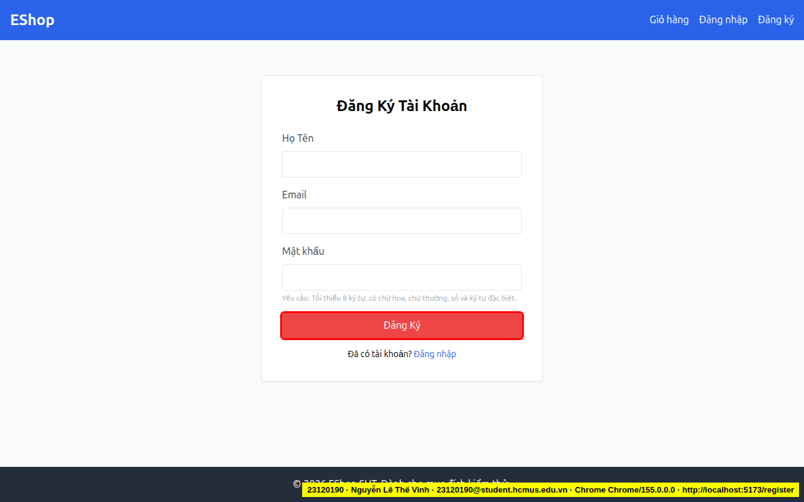

## Traceability
- Checklist item: IA-01-04 (`checklist/gui-checklist.xlsx`)
- Requirement: FR-21

---
### 6. [BUG][forgot-password] Reset and Back buttons on step 2 share the same green style
Labels: type: bug, severity: trivial, priority: P3, status: new, module: forgot-password

## Mô tả lỗi
Reset and Back buttons on step 2 share the same green style

## Môi trường
- OS: Ubuntu 26.04.1 LTS · Browser: Google Chrome 155.0.8059.84 (Playwright 1.64.1, headed)
- SUT: EShop `eshop-sut` commit `85af3ba` · Web http://localhost:5173 · API http://localhost:3000
- Test account: tài khoản tạo mới cho từng test qua `POST /api/register`; seed `test@eshop.com` / `Test1234!`

## Steps to reproduce
1. Mở http://localhost:5173/forgot-password
2. Nhập email đã đăng ký, bấm "Lấy mã OTP"
3. Quan sát nút "Đặt lại mật khẩu" và "← Quay lại"

## Actual result
Hai nút cùng nền xanh lá `rgb(22, 163, 74)`, không phân biệt chính/phụ.

## Expected result
Nút chính màu xanh dương; nút "← Quay lại" có style phụ khác hẳn.

## Evidence
**IA-01-05**

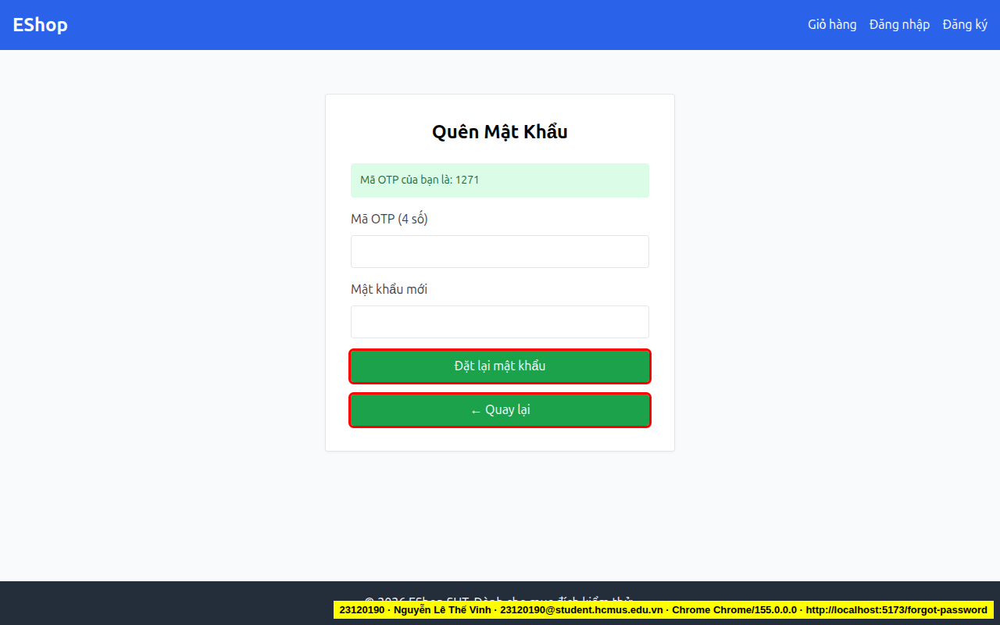

## Traceability
- Checklist item: IA-01-05 (`checklist/gui-checklist.xlsx`)
- Requirement: FR-21

---
### 7. [BUG][ui] No page has an <h1> heading
Labels: type: bug, severity: minor, priority: P3, status: new, module: ui

## Mô tả lỗi
No page has an <h1> heading

## Môi trường
- OS: Ubuntu 26.04.1 LTS · Browser: Google Chrome 155.0.8059.84 (Playwright 1.64.1, headed)
- SUT: EShop `eshop-sut` commit `85af3ba` · Web http://localhost:5173 · API http://localhost:3000
- Test account: tài khoản tạo mới cho từng test qua `POST /api/register`; seed `test@eshop.com` / `Test1234!`

## Steps to reproduce
1. Mở /login, /register, /forgot-password, /profile
2. DevTools → Elements, tìm thẻ `h1`

## Actual result
Không trang nào có `<h1>`; tiêu đề dùng `<h2>`.

## Expected result
Mỗi trang có đúng 1 `<h1>` mô tả nội dung trang.

## Evidence
**IA-01-06**

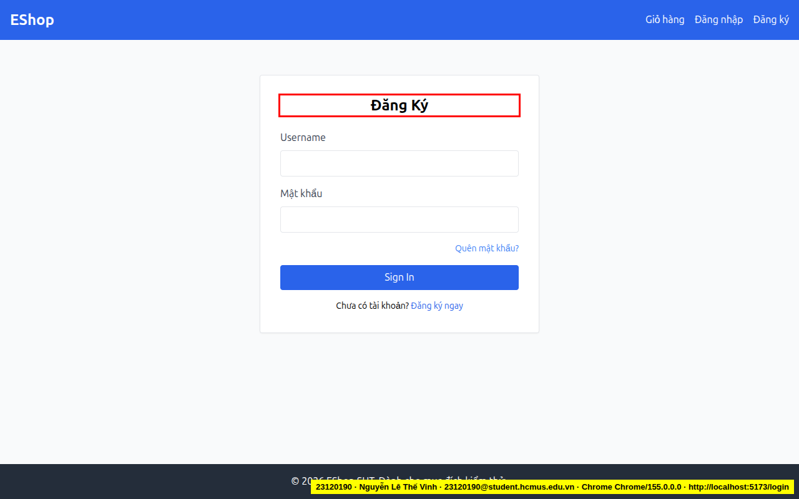

## Traceability
- Checklist item: IA-01-06 (`checklist/gui-checklist.xlsx`)
- Requirement: FR-21

---
### 8. [BUG][register] Password rule hint has insufficient contrast (2.54:1)
Labels: type: bug, severity: minor, priority: P3, status: new, module: register

## Mô tả lỗi
Password rule hint has insufficient contrast (2.54:1)

## Môi trường
- OS: Ubuntu 26.04.1 LTS · Browser: Google Chrome 155.0.8059.84 (Playwright 1.64.1, headed)
- SUT: EShop `eshop-sut` commit `85af3ba` · Web http://localhost:5173 · API http://localhost:3000
- Test account: tài khoản tạo mới cho từng test qua `POST /api/register`; seed `test@eshop.com` / `Test1234!`

## Steps to reproduce
1. Mở http://localhost:5173/register
2. DevTools → chọn dòng "Yêu cầu: Tối thiểu 8 ký tự…" → xem Contrast

## Actual result
Chữ 12px màu `rgb(156,163,175)` trên nền trắng, contrast 2.54:1.

## Expected result
Contrast ≥ 4.5:1.

## Evidence
**IA-01-08**

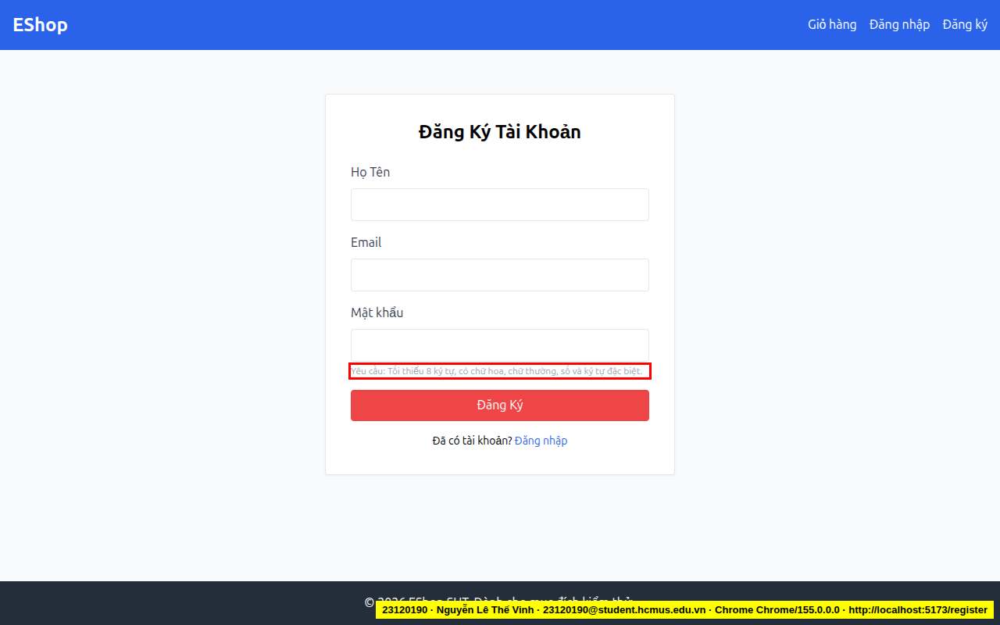

## Traceability
- Checklist item: IA-01-08 (`checklist/gui-checklist.xlsx`)
- Requirement: WCAG 1.4.3

---
### 9. [BUG][login] Sign In button has tabIndex=1 and is focused before the form fields
Labels: type: bug, severity: minor, priority: P2, status: new, module: login

## Mô tả lỗi
Sign In button has tabIndex=1 and is focused before the form fields

## Môi trường
- OS: Ubuntu 26.04.1 LTS · Browser: Google Chrome 155.0.8059.84 (Playwright 1.64.1, headed)
- SUT: EShop `eshop-sut` commit `85af3ba` · Web http://localhost:5173 · API http://localhost:3000
- Test account: tài khoản tạo mới cho từng test qua `POST /api/register`; seed `test@eshop.com` / `Test1234!`

## Steps to reproduce
1. Mở http://localhost:5173/login
2. Bấm Tab một lần

## Actual result
Focus nhảy thẳng vào nút "Sign In" (`tabIndex=1`) trước các field.

## Expected result
Thứ tự Tab: Email → Mật khẩu → "Quên mật khẩu?" → nút submit → "Đăng ký ngay".

## Evidence
**IA-01-14**

## Traceability
- Checklist item: IA-01-14 (`checklist/gui-checklist.xlsx`)
- Requirement: FR-21

---
### 10. [BUG][profile] Header greeting is not updated after saving a new name
Labels: type: bug, severity: minor, priority: P2, status: new, module: profile

## Mô tả lỗi
Header greeting is not updated after saving a new name

## Môi trường
- OS: Ubuntu 26.04.1 LTS · Browser: Google Chrome 155.0.8059.84 (Playwright 1.64.1, headed)
- SUT: EShop `eshop-sut` commit `85af3ba` · Web http://localhost:5173 · API http://localhost:3000
- Test account: tài khoản tạo mới cho từng test qua `POST /api/register`; seed `test@eshop.com` / `Test1234!`

## Steps to reproduce
1. Đăng nhập
2. Mở http://localhost:5173/profile
3. Đổi Họ Tên thành `Nguyễn Lê Thế Vinh`, bấm "Cập nhật"

## Actual result
Alert "Cập nhật thành công!" nhưng header vẫn "Chào, {tên cũ}" cho tới khi đăng nhập lại.

## Expected result
Header hiển thị ngay "Chào, Nguyễn Lê Thế Vinh" (dấu tiếng Việt hiển thị đúng).

## Evidence
**IA-04-20**

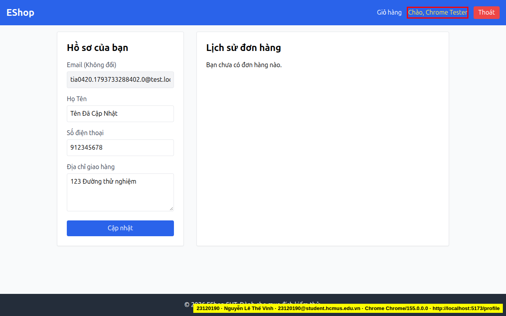
**IA-01-18**

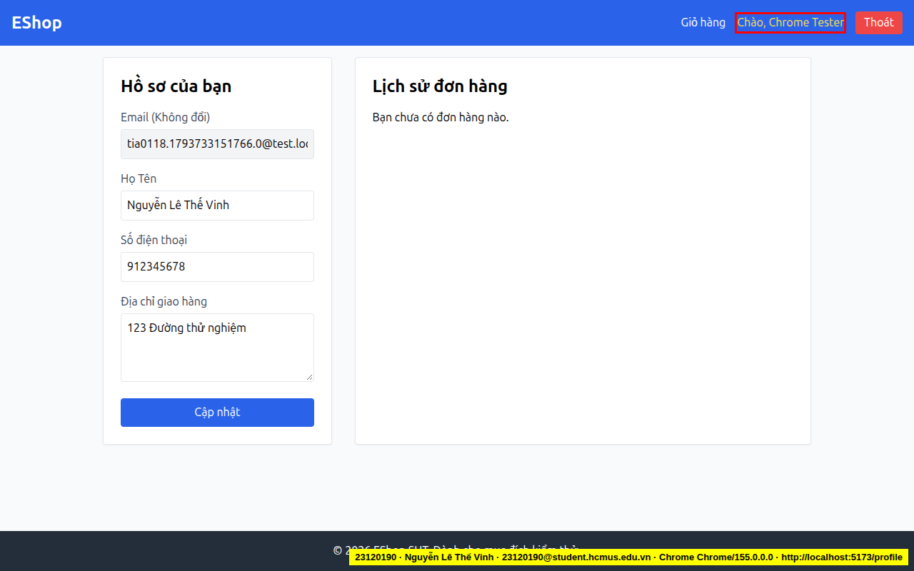

## Traceability
- Checklist item: IA-04-20, IA-01-18 (`checklist/gui-checklist.xlsx`)
- Requirement: FR-04

---
### 11. [BUG][navigation] User name is rendered as HTML in the header greeting (stored XSS)
Labels: type: bug, severity: critical, priority: P0, status: new, module: navigation

## Mô tả lỗi
User name is rendered as HTML in the header greeting (stored XSS)

## Môi trường
- OS: Ubuntu 26.04.1 LTS · Browser: Google Chrome 155.0.8059.84 (Playwright 1.64.1, headed)
- SUT: EShop `eshop-sut` commit `85af3ba` · Web http://localhost:5173 · API http://localhost:3000
- Test account: tài khoản tạo mới cho từng test qua `POST /api/register`; seed `test@eshop.com` / `Test1234!`

## Steps to reproduce
1. Mở http://localhost:5173/register, nhập Họ Tên `<b>x</b>`, đăng ký với password hợp lệ
2. Đăng nhập bằng tài khoản vừa tạo
3. Quan sát header

## Actual result
Header hiển thị "Chào, **x**" (chữ in đậm); thẻ `<b>` được render (`dangerouslySetInnerHTML`).

## Expected result
Tên hiển thị nguyên văn `Chào, <b>x</b>`; không HTML/script nào từ dữ liệu người dùng được thực thi.

## Evidence
**IA-01-20**

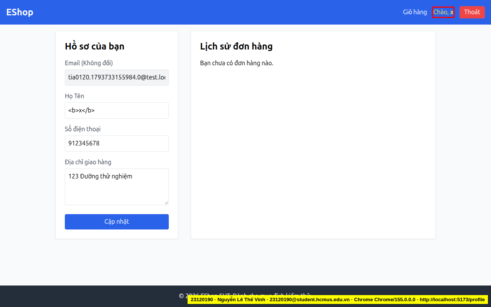

## Traceability
- Checklist item: IA-01-20 (`checklist/gui-checklist.xlsx`)
- Requirement: SEC-04

---
### 12. [BUG][ui] Required fields have no * marker
Labels: type: bug, severity: trivial, priority: P3, status: new, module: ui

## Mô tả lỗi
Required fields have no * marker

## Môi trường
- OS: Ubuntu 26.04.1 LTS · Browser: Google Chrome 155.0.8059.84 (Playwright 1.64.1, headed)
- SUT: EShop `eshop-sut` commit `85af3ba` · Web http://localhost:5173 · API http://localhost:3000
- Test account: tài khoản tạo mới cho từng test qua `POST /api/register`; seed `test@eshop.com` / `Test1234!`

## Steps to reproduce
1. Mở /login, /register, /forgot-password, /profile
2. Quan sát nhãn các field bắt buộc

## Actual result
Không nhãn nào có dấu `*` dù field có `required`.

## Expected result
Mọi field bắt buộc có `*` cạnh nhãn.

## Evidence
**IA-02-01**

## Traceability
- Checklist item: IA-02-01 (`checklist/gui-checklist.xlsx`)
- Requirement: FR-22

---
### 13. [BUG][ui] Form labels are not associated with their inputs
Labels: type: bug, severity: minor, priority: P3, status: new, module: ui

## Mô tả lỗi
Form labels are not associated with their inputs

## Môi trường
- OS: Ubuntu 26.04.1 LTS · Browser: Google Chrome 155.0.8059.84 (Playwright 1.64.1, headed)
- SUT: EShop `eshop-sut` commit `85af3ba` · Web http://localhost:5173 · API http://localhost:3000
- Test account: tài khoản tạo mới cho từng test qua `POST /api/register`; seed `test@eshop.com` / `Test1234!`

## Steps to reproduce
1. Mở /login hoặc /register
2. Click vào chữ của nhãn (ví dụ "Mật khẩu")

## Actual result
Input không nhận focus; `<label>` không có `for`, input không có `id`.

## Expected result
Click nhãn sẽ focus input tương ứng (`<label for>` khớp `id`).

## Evidence
**IA-02-02**

## Traceability
- Checklist item: IA-02-02 (`checklist/gui-checklist.xlsx`)
- Requirement: WCAG 1.3.1

---
### 14. [BUG][register] Register form has no Confirm Password field
Labels: type: bug, severity: major, priority: P1, status: new, module: register

## Mô tả lỗi
Register form has no Confirm Password field

## Môi trường
- OS: Ubuntu 26.04.1 LTS · Browser: Google Chrome 155.0.8059.84 (Playwright 1.64.1, headed)
- SUT: EShop `eshop-sut` commit `85af3ba` · Web http://localhost:5173 · API http://localhost:3000
- Test account: tài khoản tạo mới cho từng test qua `POST /api/register`; seed `test@eshop.com` / `Test1234!`

## Steps to reproduce
1. Mở http://localhost:5173/register

## Actual result
Form chỉ có Họ Tên, Email, Mật khẩu.

## Expected result
Có field "Xác nhận mật khẩu"; mismatch thì báo lỗi và không tạo tài khoản.

## Evidence
**IA-02-05**

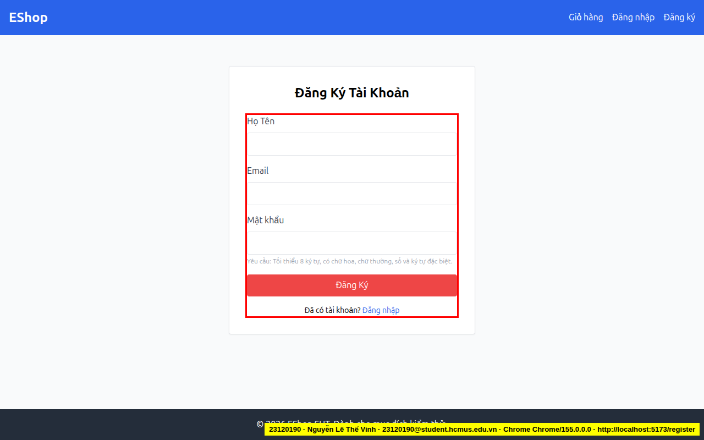

## Traceability
- Checklist item: IA-02-05 (`checklist/gui-checklist.xlsx`)
- Requirement: FR-01

---
### 15. [BUG][register] Password validator requires a space and rejects special characters, contradicting its own message
Labels: type: bug, severity: critical, priority: P0, status: new, module: register

## Mô tả lỗi
Password validator requires a space and rejects special characters, contradicting its own message

## Môi trường
- OS: Ubuntu 26.04.1 LTS · Browser: Google Chrome 155.0.8059.84 (Playwright 1.64.1, headed)
- SUT: EShop `eshop-sut` commit `85af3ba` · Web http://localhost:5173 · API http://localhost:3000
- Test account: tài khoản tạo mới cho từng test qua `POST /api/register`; seed `test@eshop.com` / `Test1234!`

## Steps to reproduce
1. Mở http://localhost:5173/register
2. Nhập Họ Tên, Email mới, Mật khẩu `Abc12345!` (đủ hoa, thường, số, ký tự đặc biệt)
3. Bấm "Đăng Ký"
4. Thử lại với `Abc12345 ` (có dấu cách)

## Actual result
`Abc12345!` bị từ chối với thông báo "…phải có KÝ TỰ ĐẶC BIỆT"; `Abc12345 ` (không có ký tự đặc biệt) lại được chấp nhận. Lỗi tương tự ở Forgot Password step 2.

## Expected result
Password đúng FR-01 (≥8, hoa, thường, số, ký tự `@$!%*?&`) được chấp nhận; thông báo khớp với rule thực tế.

## Evidence
**IA-02-06**

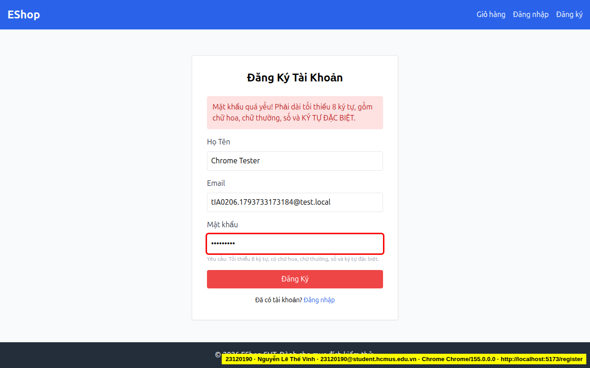
**IA-04-05**

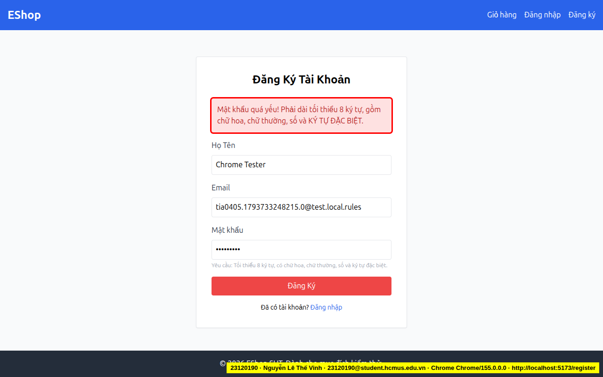

## Traceability
- Checklist item: IA-02-06, IA-04-05 (`checklist/gui-checklist.xlsx`)
- Requirement: FR-01, FR-03

---
### 16. [BUG][register] Duplicate email is accepted, including case/space variants
Labels: type: bug, severity: critical, priority: P1, status: new, module: register

## Mô tả lỗi
Duplicate email is accepted, including case/space variants

## Môi trường
- OS: Ubuntu 26.04.1 LTS · Browser: Google Chrome 155.0.8059.84 (Playwright 1.64.1, headed)
- SUT: EShop `eshop-sut` commit `85af3ba` · Web http://localhost:5173 · API http://localhost:3000
- Test account: tài khoản tạo mới cho từng test qua `POST /api/register`; seed `test@eshop.com` / `Test1234!`

## Steps to reproduce
1. Mở http://localhost:5173/register
2. Đăng ký với email `test@eshop.com` (đã tồn tại) và password hợp lệ
3. Lặp lại với `Test@EShop.com ` (hoa + dấu cách)

## Actual result
API trả 200 "User registered successfully", redirect sang Login; không có thông báo trùng email.

## Expected result
Đăng ký bị từ chối với thông báo email đã được sử dụng; email so sánh không phân biệt hoa/thường, đã trim khoảng trắng.

## Evidence
**IA-02-07**

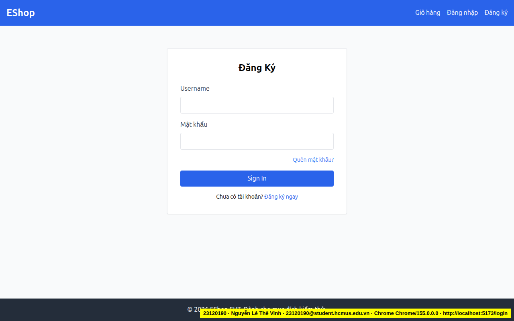
**IA-04-06**

**IA-02-19**

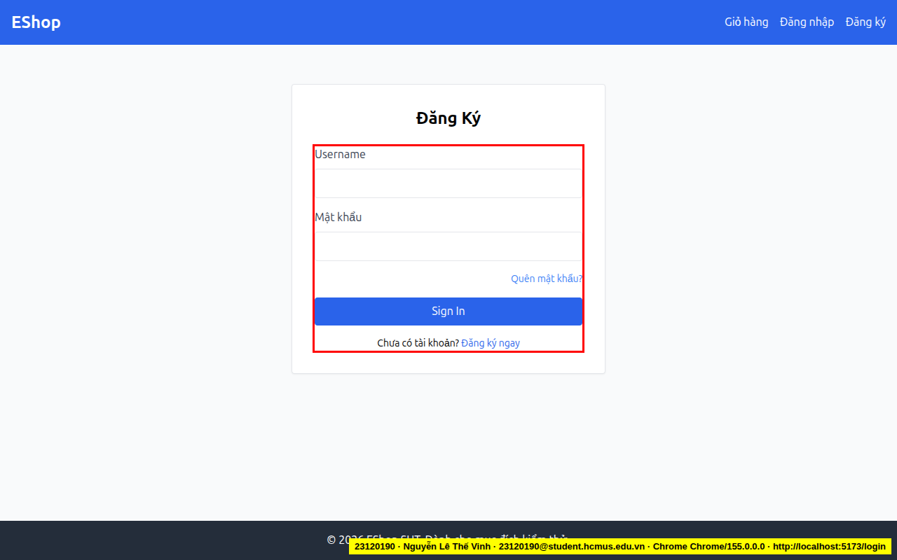

## Traceability
- Checklist item: IA-02-07, IA-04-06, IA-02-19 (`checklist/gui-checklist.xlsx`)
- Requirement: FR-01

---
### 17. [BUG][login] Login error banner is shown below the submit button
Labels: type: bug, severity: trivial, priority: P3, status: new, module: login

## Mô tả lỗi
Login error banner is shown below the submit button

## Môi trường
- OS: Ubuntu 26.04.1 LTS · Browser: Google Chrome 155.0.8059.84 (Playwright 1.64.1, headed)
- SUT: EShop `eshop-sut` commit `85af3ba` · Web http://localhost:5173 · API http://localhost:3000
- Test account: tài khoản tạo mới cho từng test qua `POST /api/register`; seed `test@eshop.com` / `Test1234!`

## Steps to reproduce
1. Mở http://localhost:5173/login
2. Nhập sai password, bấm "Sign In"

## Actual result
Banner lỗi nằm dưới nút submit và link "Đăng ký ngay".

## Expected result
Thông báo lỗi nằm trên nút submit.

## Evidence
**IA-02-08**

## Traceability
- Checklist item: IA-02-08 (`checklist/gui-checklist.xlsx`)
- Requirement: FR-22

---
### 18. [BUG][forgot-password] Forgot Password has no step indicator
Labels: type: bug, severity: minor, priority: P2, status: new, module: forgot-password

## Mô tả lỗi
Forgot Password has no step indicator

## Môi trường
- OS: Ubuntu 26.04.1 LTS · Browser: Google Chrome 155.0.8059.84 (Playwright 1.64.1, headed)
- SUT: EShop `eshop-sut` commit `85af3ba` · Web http://localhost:5173 · API http://localhost:3000
- Test account: tài khoản tạo mới cho từng test qua `POST /api/register`; seed `test@eshop.com` / `Test1234!`

## Steps to reproduce
1. Mở http://localhost:5173/forgot-password
2. Nhập email, bấm "Lấy mã OTP"

## Actual result
Cả step 1 và step 2 không có chỉ báo bước.

## Expected result
Hiển thị "Bước 1 / 2" và "Bước 2 / 2".

## Evidence
**IA-02-09**

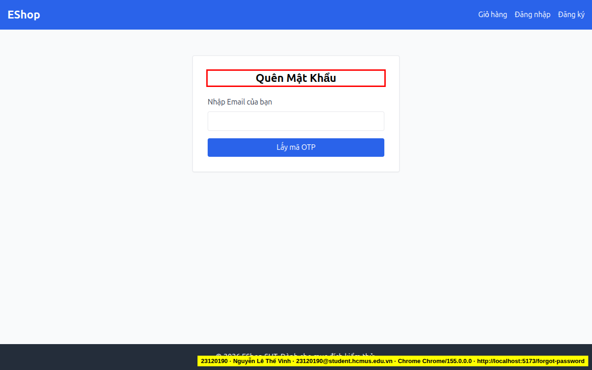
**IA-02-11**

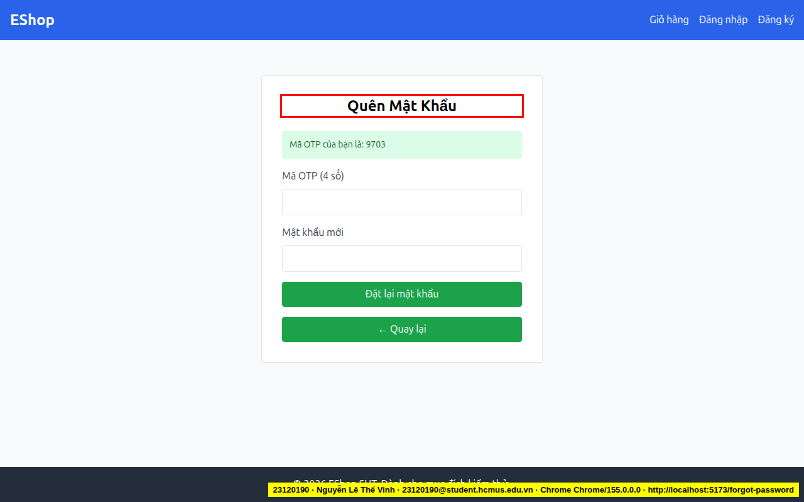

## Traceability
- Checklist item: IA-02-09, IA-02-11 (`checklist/gui-checklist.xlsx`)
- Requirement: FR-03, FR-22

---
### 19. [BUG][forgot-password] OTP has only 4 digits and the OTP input has no length validation
Labels: type: bug, severity: major, priority: P1, status: new, module: forgot-password

## Mô tả lỗi
OTP has only 4 digits and the OTP input has no length validation

## Môi trường
- OS: Ubuntu 26.04.1 LTS · Browser: Google Chrome 155.0.8059.84 (Playwright 1.64.1, headed)
- SUT: EShop `eshop-sut` commit `85af3ba` · Web http://localhost:5173 · API http://localhost:3000
- Test account: tài khoản tạo mới cho từng test qua `POST /api/register`; seed `test@eshop.com` / `Test1234!`

## Steps to reproduce
1. Mở http://localhost:5173/forgot-password
2. Nhập email đã đăng ký, bấm "Lấy mã OTP"
3. Nhập `12345` hoặc `1234567` vào ô OTP, submit

## Actual result
OTP hiển thị 4 chữ số, nhãn "Mã OTP (4 số)"; input không giới hạn độ dài, chỉ báo alert chung.

## Expected result
OTP 6 chữ số; input chỉ nhận đúng 6 chữ số.

## Evidence
**IA-02-12**

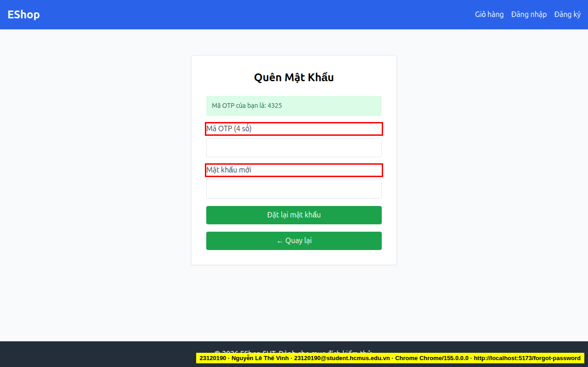

## Traceability
- Checklist item: IA-02-12 (`checklist/gui-checklist.xlsx`)
- Requirement: FR-03, SEC-07

---
### 20. [BUG][forgot-password] Reset form has no Confirm New Password field
Labels: type: bug, severity: major, priority: P2, status: new, module: forgot-password

## Mô tả lỗi
Reset form has no Confirm New Password field

## Môi trường
- OS: Ubuntu 26.04.1 LTS · Browser: Google Chrome 155.0.8059.84 (Playwright 1.64.1, headed)
- SUT: EShop `eshop-sut` commit `85af3ba` · Web http://localhost:5173 · API http://localhost:3000
- Test account: tài khoản tạo mới cho từng test qua `POST /api/register`; seed `test@eshop.com` / `Test1234!`

## Steps to reproduce
1. Đi tới step 2 của Forgot Password

## Actual result
Chỉ có "Mã OTP" và "Mật khẩu mới".

## Expected result
Có field "Xác nhận mật khẩu mới"; mismatch thì báo lỗi.

## Evidence
**IA-02-13**

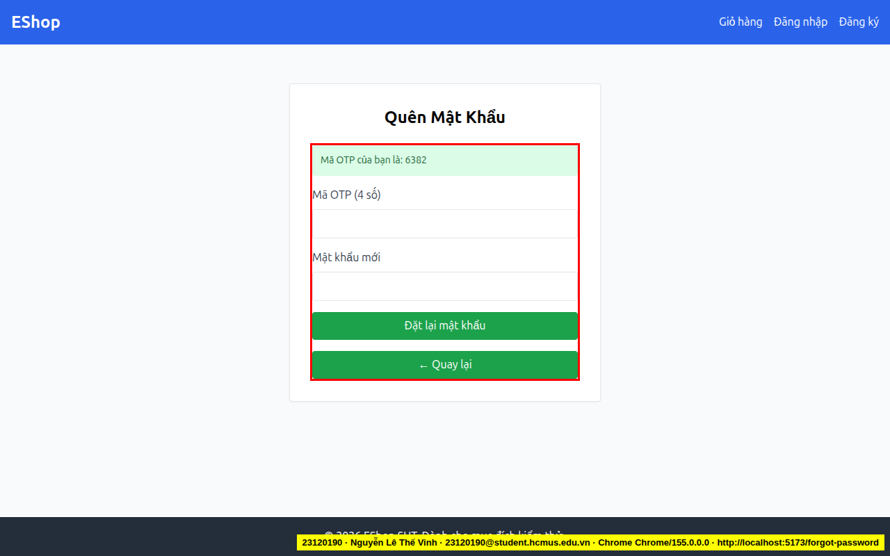

## Traceability
- Checklist item: IA-02-13 (`checklist/gui-checklist.xlsx`)
- Requirement: FR-03

---
### 21. [BUG][ui] Feedback uses blocking alert() instead of inline messages
Labels: type: bug, severity: minor, priority: P2, status: new, module: ui

## Mô tả lỗi
Feedback uses blocking alert() instead of inline messages

## Môi trường
- OS: Ubuntu 26.04.1 LTS · Browser: Google Chrome 155.0.8059.84 (Playwright 1.64.1, headed)
- SUT: EShop `eshop-sut` commit `85af3ba` · Web http://localhost:5173 · API http://localhost:3000
- Test account: tài khoản tạo mới cho từng test qua `POST /api/register`; seed `test@eshop.com` / `Test1234!`

## Steps to reproduce
1. Forgot Password step 2: nhập OTP sai, submit
2. Profile: bấm "Cập nhật"

## Actual result
Kết quả hiện bằng hộp thoại `alert()` của trình duyệt ("Mã OTP không đúng…", "Cập nhật thành công!"); không có thông báo trong trang.

## Expected result
Thông báo hiển thị inline trong trang (trên nút submit), không chặn thao tác.

## Evidence
**IA-02-14**

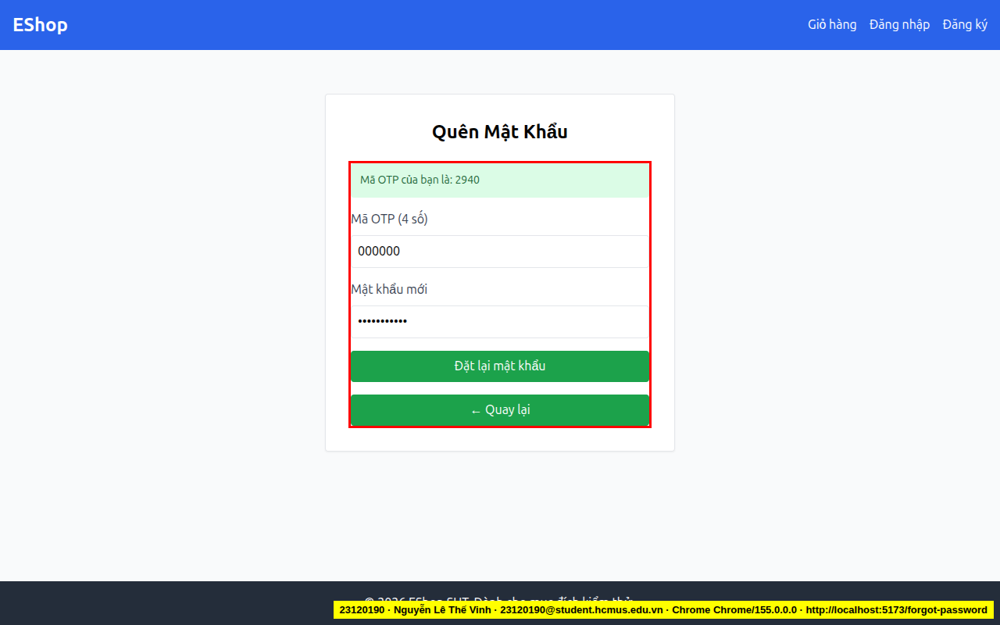
**IA-04-11**

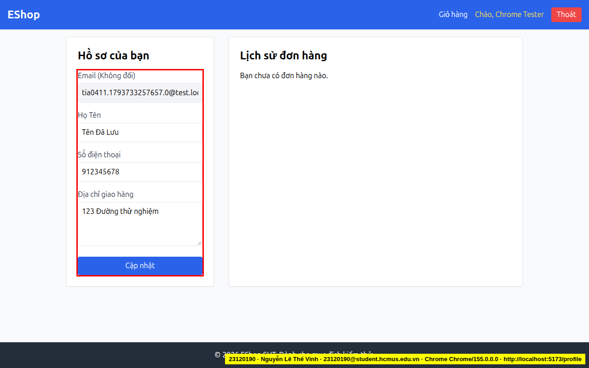

## Traceability
- Checklist item: IA-02-14, IA-04-11 (`checklist/gui-checklist.xlsx`)
- Requirement: FR-22

---
### 22. [BUG][forgot-password] Unknown email reveals "User not found" (account enumeration)
Labels: type: bug, severity: major, priority: P2, status: new, module: forgot-password

## Mô tả lỗi
Unknown email reveals "User not found" (account enumeration)

## Môi trường
- OS: Ubuntu 26.04.1 LTS · Browser: Google Chrome 155.0.8059.84 (Playwright 1.64.1, headed)
- SUT: EShop `eshop-sut` commit `85af3ba` · Web http://localhost:5173 · API http://localhost:3000
- Test account: tài khoản tạo mới cho từng test qua `POST /api/register`; seed `test@eshop.com` / `Test1234!`

## Steps to reproduce
1. Mở http://localhost:5173/forgot-password
2. Nhập `khongtontai@test.local`, bấm "Lấy mã OTP"

## Actual result
Alert "Lỗi: User not found" (API 404).

## Expected result
Thông báo chung không tiết lộ email có tồn tại hay không, hiển thị inline.

## Evidence
**IA-04-07**

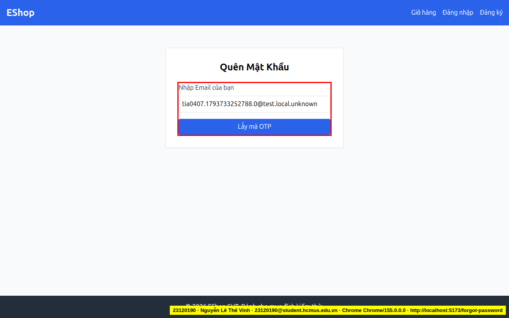

## Traceability
- Checklist item: IA-04-07 (`checklist/gui-checklist.xlsx`)
- Requirement: FR-03

---
### 23. [BUG][profile] Valid phone numbers starting with 0 are rejected
Labels: type: bug, severity: major, priority: P1, status: new, module: profile

## Mô tả lỗi
Valid phone numbers starting with 0 are rejected

## Môi trường
- OS: Ubuntu 26.04.1 LTS · Browser: Google Chrome 155.0.8059.84 (Playwright 1.64.1, headed)
- SUT: EShop `eshop-sut` commit `85af3ba` · Web http://localhost:5173 · API http://localhost:3000
- Test account: tài khoản tạo mới cho từng test qua `POST /api/register`; seed `test@eshop.com` / `Test1234!`

## Steps to reproduce
1. Đăng nhập, mở /profile
2. Nhập Số điện thoại `0912345678`, bấm "Cập nhật"

## Actual result
Alert "Số điện thoại không hợp lệ. Vui lòng nhập đúng 9-10 chữ số."; không lưu. Số `912345678` (thiếu 0) lại được chấp nhận. Lỗi server chỉ báo "Lỗi cập nhật".

## Expected result
`0912345678`, `09123456789` được lưu; số không bắt đầu bằng 0 bị từ chối với thông báo nêu đúng rule.

## Evidence
**IA-02-15**

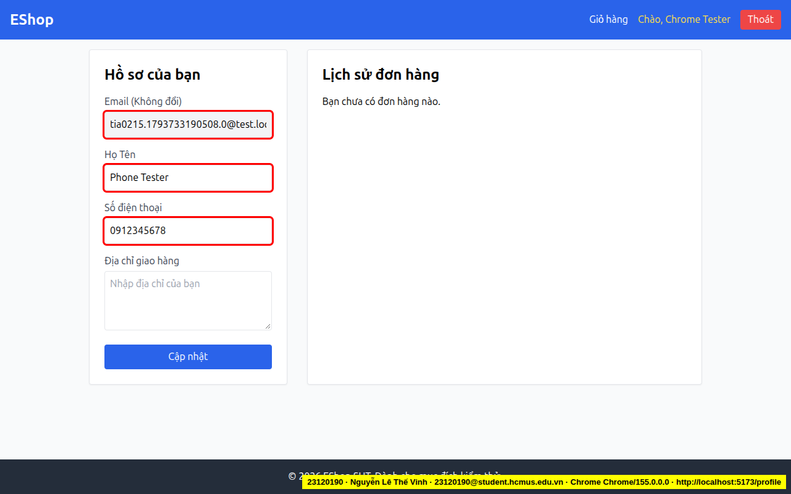
**IA-04-12**

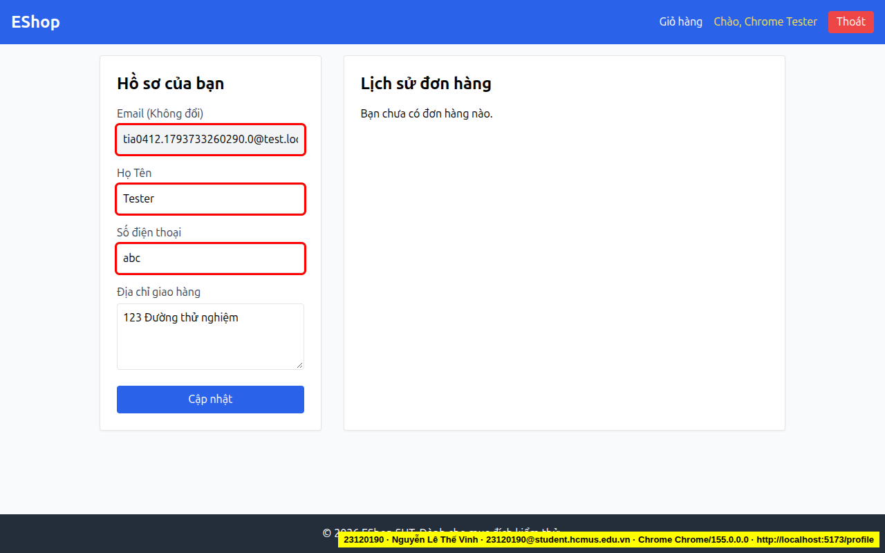

## Traceability
- Checklist item: IA-02-15, IA-04-12 (`checklist/gui-checklist.xlsx`)
- Requirement: FR-04

---
### 24. [BUG][ui] Email/password fields have no autocomplete attributes
Labels: type: bug, severity: trivial, priority: P3, status: new, module: ui

## Mô tả lỗi
Email/password fields have no autocomplete attributes

## Môi trường
- OS: Ubuntu 26.04.1 LTS · Browser: Google Chrome 155.0.8059.84 (Playwright 1.64.1, headed)
- SUT: EShop `eshop-sut` commit `85af3ba` · Web http://localhost:5173 · API http://localhost:3000
- Test account: tài khoản tạo mới cho từng test qua `POST /api/register`; seed `test@eshop.com` / `Test1234!`

## Steps to reproduce
1. Mở /login, /register; DevTools → Elements

## Actual result
Không có `autocomplete` trên field email/password.

## Expected result
`autocomplete="email"`, `current-password`, `new-password` đúng chỗ.

## Evidence
**IA-02-18**

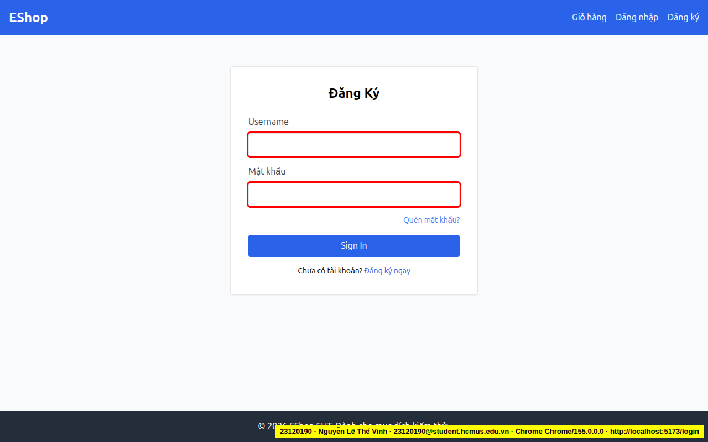

## Traceability
- Checklist item: IA-02-18 (`checklist/gui-checklist.xlsx`)
- Requirement: —

---
### 25. [BUG][forgot-password] New-password rule is not shown on reset step 2
Labels: type: bug, severity: minor, priority: P3, status: new, module: forgot-password

## Mô tả lỗi
New-password rule is not shown on reset step 2

## Môi trường
- OS: Ubuntu 26.04.1 LTS · Browser: Google Chrome 155.0.8059.84 (Playwright 1.64.1, headed)
- SUT: EShop `eshop-sut` commit `85af3ba` · Web http://localhost:5173 · API http://localhost:3000
- Test account: tài khoản tạo mới cho từng test qua `POST /api/register`; seed `test@eshop.com` / `Test1234!`

## Steps to reproduce
1. Đi tới step 2 của Forgot Password

## Actual result
Không có gợi ý rule mật khẩu (Register có).

## Expected result
Hiển thị rule FR-01 cạnh "Mật khẩu mới" như ở Register.

## Evidence
**IA-02-20**

## Traceability
- Checklist item: IA-02-20 (`checklist/gui-checklist.xlsx`)
- Requirement: FR-03

---
### 26. [BUG][forgot-password] Pasted OTP with surrounding spaces is rejected
Labels: type: bug, severity: minor, priority: P2, status: new, module: forgot-password

## Mô tả lỗi
Pasted OTP with surrounding spaces is rejected

## Môi trường
- OS: Ubuntu 26.04.1 LTS · Browser: Google Chrome 155.0.8059.84 (Playwright 1.64.1, headed)
- SUT: EShop `eshop-sut` commit `85af3ba` · Web http://localhost:5173 · API http://localhost:3000
- Test account: tài khoản tạo mới cho từng test qua `POST /api/register`; seed `test@eshop.com` / `Test1234!`

## Steps to reproduce
1. Đi tới step 2, bôi đen và copy OTP từ hộp xanh
2. Paste vào ô OTP (giá trị dạng ` 4967 `), nhập password mới, submit

## Actual result
Alert "Mã OTP không đúng hoặc có lỗi xảy ra." vì khoảng trắng không được trim.

## Expected result
OTP được trim trước khi kiểm tra; reset thành công.

## Evidence
**IA-02-21**

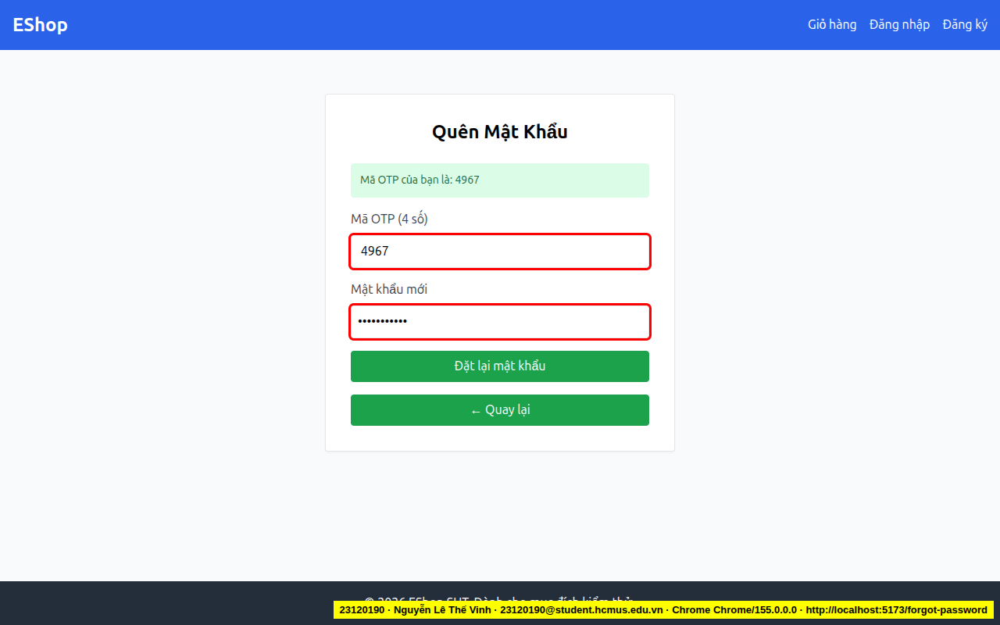

## Traceability
- Checklist item: IA-02-21 (`checklist/gui-checklist.xlsx`)
- Requirement: —

---
### 27. [BUG][profile] Long email is cut off in the read-only Profile field
Labels: type: bug, severity: trivial, priority: P3, status: new, module: profile

## Mô tả lỗi
Long email is cut off in the read-only Profile field

## Môi trường
- OS: Ubuntu 26.04.1 LTS · Browser: Google Chrome 155.0.8059.84 (Playwright 1.64.1, headed)
- SUT: EShop `eshop-sut` commit `85af3ba` · Web http://localhost:5173 · API http://localhost:3000
- Test account: tài khoản tạo mới cho từng test qua `POST /api/register`; seed `test@eshop.com` / `Test1234!`

## Steps to reproduce
1. Đăng nhập bằng email dài (~60 ký tự)
2. Mở /profile

## Actual result
Email bị cắt (clientWidth 269 < scrollWidth 557), field disabled nên không cuộn/không có tooltip.

## Expected result
Đọc được đầy đủ email (xuống dòng hoặc tooltip).

## Evidence
**IA-02-22**

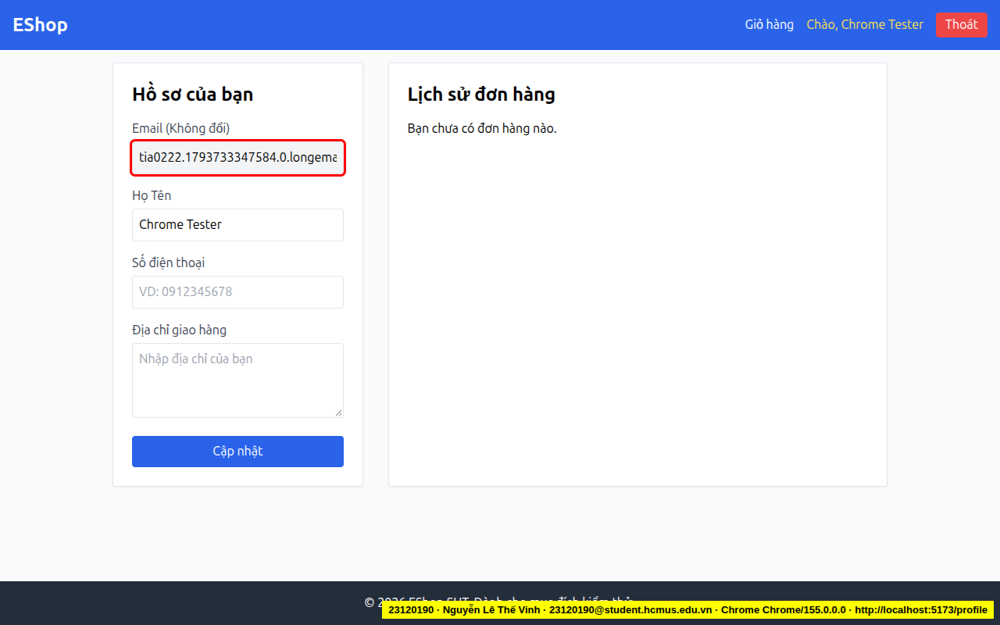

## Traceability
- Checklist item: IA-02-22 (`checklist/gui-checklist.xlsx`)
- Requirement: FR-04

---
### 28. [BUG][navigation] Navbar does not highlight the current page
Labels: type: bug, severity: trivial, priority: P3, status: new, module: navigation

## Mô tả lỗi
Navbar does not highlight the current page

## Môi trường
- OS: Ubuntu 26.04.1 LTS · Browser: Google Chrome 155.0.8059.84 (Playwright 1.64.1, headed)
- SUT: EShop `eshop-sut` commit `85af3ba` · Web http://localhost:5173 · API http://localhost:3000
- Test account: tài khoản tạo mới cho từng test qua `POST /api/register`; seed `test@eshop.com` / `Test1234!`

## Steps to reproduce
1. Mở /login, /register, /profile
2. Quan sát mục tương ứng trên navbar

## Actual result
Mục của trang hiện tại có style giống hệt các mục khác.

## Expected result
Mục trang hiện tại được highlight (màu/gạch chân/nền khác).

## Evidence
**IA-03-03**

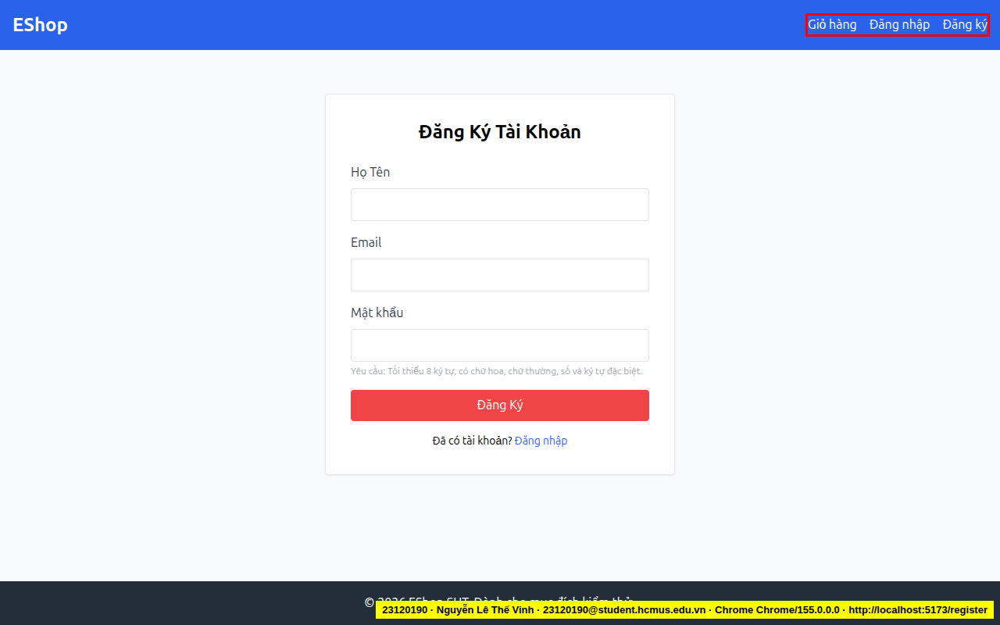

## Traceability
- Checklist item: IA-03-03 (`checklist/gui-checklist.xlsx`)
- Requirement: FR-23

---
### 29. [BUG][navigation] Cart link has no item-count badge
Labels: type: bug, severity: minor, priority: P2, status: new, module: navigation

## Mô tả lỗi
Cart link has no item-count badge

## Môi trường
- OS: Ubuntu 26.04.1 LTS · Browser: Google Chrome 155.0.8059.84 (Playwright 1.64.1, headed)
- SUT: EShop `eshop-sut` commit `85af3ba` · Web http://localhost:5173 · API http://localhost:3000
- Test account: tài khoản tạo mới cho từng test qua `POST /api/register`; seed `test@eshop.com` / `Test1234!`

## Steps to reproduce
1. Thêm 1 sản phẩm vào giỏ
2. Quan sát link "Giỏ hàng" trên header

## Actual result
Link chỉ có chữ "Giỏ hàng", không có badge.

## Expected result
Badge hiển thị số lượng (1).

## Evidence
**IA-03-04**

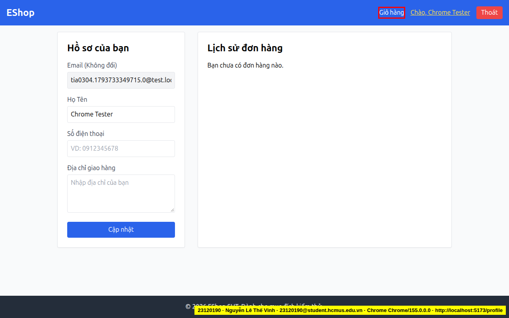

## Traceability
- Checklist item: IA-03-04 (`checklist/gui-checklist.xlsx`)
- Requirement: FR-23

---
### 30. [BUG][navigation] Logout button is labelled "Thoát" instead of "Đăng xuất"
Labels: type: bug, severity: trivial, priority: P3, status: new, module: navigation

## Mô tả lỗi
Logout button is labelled "Thoát" instead of "Đăng xuất"

## Môi trường
- OS: Ubuntu 26.04.1 LTS · Browser: Google Chrome 155.0.8059.84 (Playwright 1.64.1, headed)
- SUT: EShop `eshop-sut` commit `85af3ba` · Web http://localhost:5173 · API http://localhost:3000
- Test account: tài khoản tạo mới cho từng test qua `POST /api/register`; seed `test@eshop.com` / `Test1234!`

## Steps to reproduce
1. Đăng nhập
2. Quan sát nút logout trên header

## Actual result
Nút ghi "Thoát".

## Expected result
Nút ghi "Đăng xuất".

## Evidence
**IA-03-05**

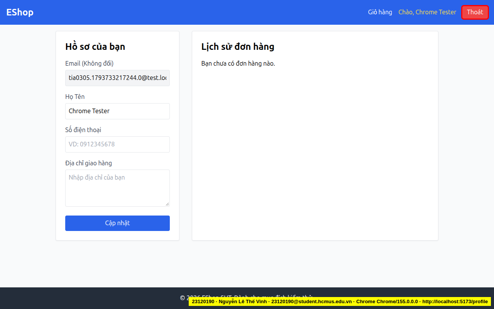

## Traceability
- Checklist item: IA-03-05 (`checklist/gui-checklist.xlsx`)
- Requirement: FR-23

---
### 31. [BUG][login] "Quên mật khẩu?" link triggers a full page reload
Labels: type: bug, severity: trivial, priority: P3, status: new, module: login

## Mô tả lỗi
"Quên mật khẩu?" link triggers a full page reload

## Môi trường
- OS: Ubuntu 26.04.1 LTS · Browser: Google Chrome 155.0.8059.84 (Playwright 1.64.1, headed)
- SUT: EShop `eshop-sut` commit `85af3ba` · Web http://localhost:5173 · API http://localhost:3000
- Test account: tài khoản tạo mới cho từng test qua `POST /api/register`; seed `test@eshop.com` / `Test1234!`

## Steps to reproduce
1. Mở http://localhost:5173/login
2. Bấm "Quên mật khẩu?"

## Actual result
Trình duyệt tải lại toàn bộ trang (1 document request) thay vì điều hướng SPA.

## Expected result
Điều hướng trong SPA, không tải lại trang.

## Evidence
**IA-03-07**

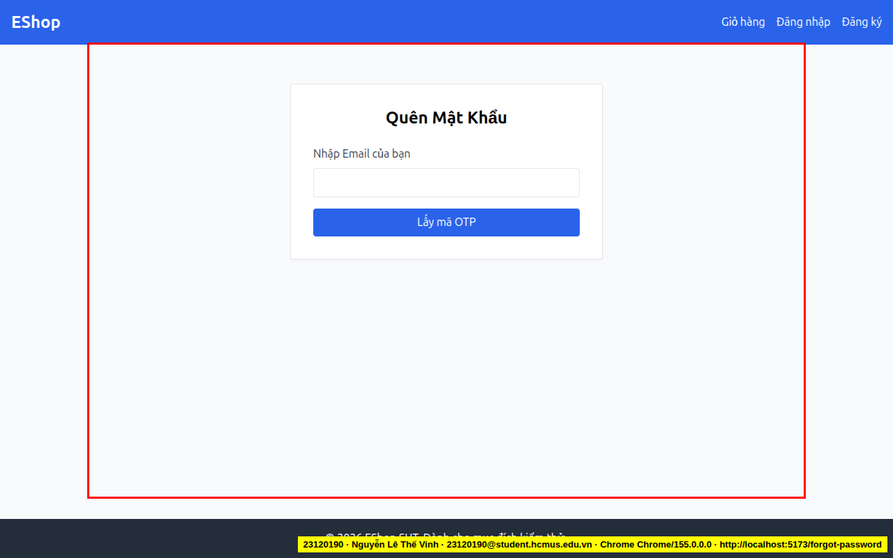

## Traceability
- Checklist item: IA-03-07 (`checklist/gui-checklist.xlsx`)
- Requirement: —

---
### 32. [BUG][forgot-password] Step 1 has no "Quay lại đăng nhập" button
Labels: type: bug, severity: minor, priority: P2, status: new, module: forgot-password

## Mô tả lỗi
Step 1 has no "Quay lại đăng nhập" button

## Môi trường
- OS: Ubuntu 26.04.1 LTS · Browser: Google Chrome 155.0.8059.84 (Playwright 1.64.1, headed)
- SUT: EShop `eshop-sut` commit `85af3ba` · Web http://localhost:5173 · API http://localhost:3000
- Test account: tài khoản tạo mới cho từng test qua `POST /api/register`; seed `test@eshop.com` / `Test1234!`

## Steps to reproduce
1. Mở http://localhost:5173/forgot-password

## Actual result
Chỉ có nút "Lấy mã OTP".

## Expected result
Có nút "Quay lại đăng nhập" dẫn về /login.

## Evidence
**IA-03-10**

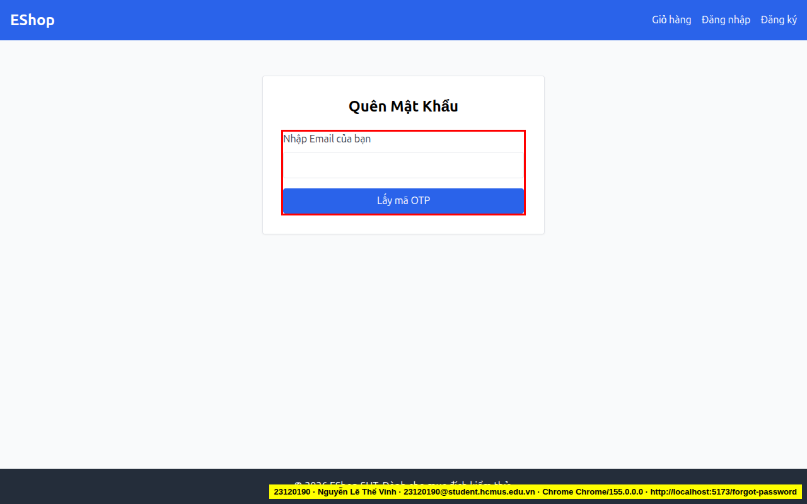

## Traceability
- Checklist item: IA-03-10 (`checklist/gui-checklist.xlsx`)
- Requirement: FR-03

---
### 33. [BUG][forgot-password] Refreshing step 2 loses the reset progress
Labels: type: bug, severity: minor, priority: P3, status: new, module: forgot-password

## Mô tả lỗi
Refreshing step 2 loses the reset progress

## Môi trường
- OS: Ubuntu 26.04.1 LTS · Browser: Google Chrome 155.0.8059.84 (Playwright 1.64.1, headed)
- SUT: EShop `eshop-sut` commit `85af3ba` · Web http://localhost:5173 · API http://localhost:3000
- Test account: tài khoản tạo mới cho từng test qua `POST /api/register`; seed `test@eshop.com` / `Test1234!`

## Steps to reproduce
1. Đi tới step 2 của Forgot Password
2. Bấm F5

## Actual result
Quay về step 1, email trống; OTP đã cấp không còn hiển thị.

## Expected result
Vẫn ở step 2 và giữ email.

## Evidence
**IA-03-12**

## Traceability
- Checklist item: IA-03-12 (`checklist/gui-checklist.xlsx`)
- Requirement: —

---
### 34. [BUG][profile] Logged-out /profile shows a dead-end message instead of redirecting
Labels: type: bug, severity: minor, priority: P3, status: new, module: profile

## Mô tả lỗi
Logged-out /profile shows a dead-end message instead of redirecting

## Môi trường
- OS: Ubuntu 26.04.1 LTS · Browser: Google Chrome 155.0.8059.84 (Playwright 1.64.1, headed)
- SUT: EShop `eshop-sut` commit `85af3ba` · Web http://localhost:5173 · API http://localhost:3000
- Test account: tài khoản tạo mới cho từng test qua `POST /api/register`; seed `test@eshop.com` / `Test1234!`

## Steps to reproduce
1. Đăng xuất
2. Mở http://localhost:5173/profile

## Actual result
Trang chỉ có chữ "Vui lòng đăng nhập", không redirect, không có link.

## Expected result
Redirect sang /login.

## Evidence
**IA-03-16**

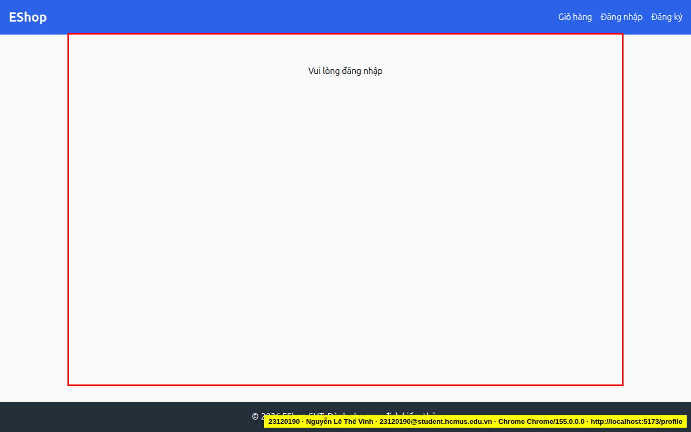

## Traceability
- Checklist item: IA-03-16 (`checklist/gui-checklist.xlsx`)
- Requirement: FR-04

---
### 35. [BUG][navigation] Logged-in users can still open /login and /register
Labels: type: bug, severity: minor, priority: P3, status: new, module: navigation

## Mô tả lỗi
Logged-in users can still open /login and /register

## Môi trường
- OS: Ubuntu 26.04.1 LTS · Browser: Google Chrome 155.0.8059.84 (Playwright 1.64.1, headed)
- SUT: EShop `eshop-sut` commit `85af3ba` · Web http://localhost:5173 · API http://localhost:3000
- Test account: tài khoản tạo mới cho từng test qua `POST /api/register`; seed `test@eshop.com` / `Test1234!`

## Steps to reproduce
1. Đăng nhập
2. Mở http://localhost:5173/login, sau đó http://localhost:5173/register

## Actual result
Form Login/Register vẫn hiển thị dù header đang "Chào, …".

## Expected result
Redirect về `/`.

## Evidence
**IA-03-17**

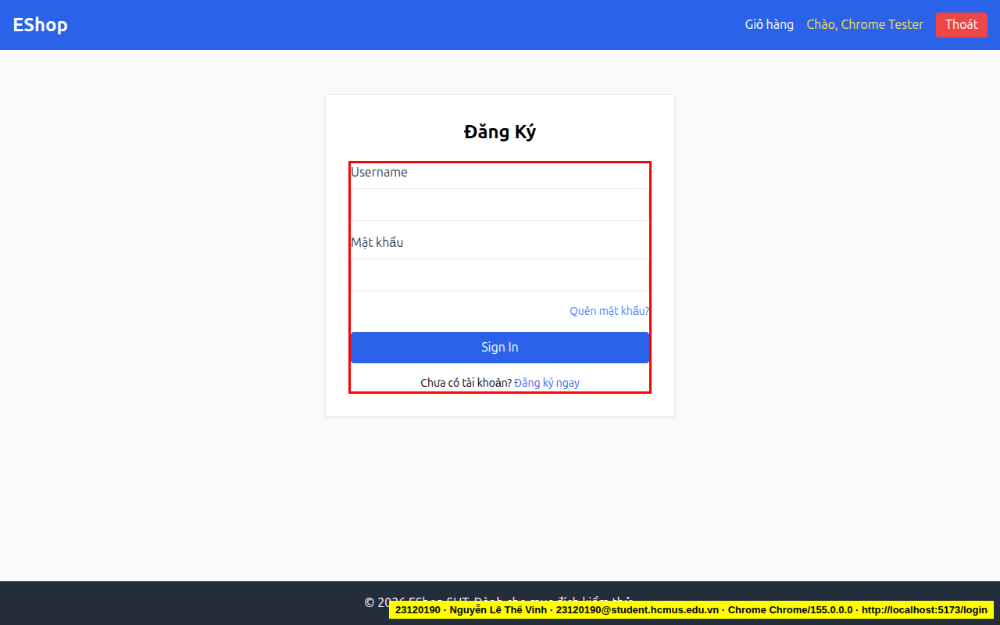
**IA-03-18**

## Traceability
- Checklist item: IA-03-17, IA-03-18 (`checklist/gui-checklist.xlsx`)
- Requirement: —

---
### 36. [BUG][login] Locked account shows the same generic error as a wrong password
Labels: type: bug, severity: major, priority: P2, status: new, module: login

## Mô tả lỗi
Locked account shows the same generic error as a wrong password

## Môi trường
- OS: Ubuntu 26.04.1 LTS · Browser: Google Chrome 155.0.8059.84 (Playwright 1.64.1, headed)
- SUT: EShop `eshop-sut` commit `85af3ba` · Web http://localhost:5173 · API http://localhost:3000
- Test account: tài khoản tạo mới cho từng test qua `POST /api/register`; seed `test@eshop.com` / `Test1234!`

## Steps to reproduce
1. Tạo tài khoản mới
2. Đăng nhập sai password 2 lần
3. Đăng nhập lại bằng password đúng

## Actual result
Vẫn chỉ "Đăng nhập thất bại. Vui lòng kiểm tra lại."; người dùng không biết tài khoản bị khóa (API trả 403 "Tài khoản đã bị khóa…" nhưng UI không hiển thị).

## Expected result
Hiển thị thông báo khóa phù hợp (ví dụ "Tài khoản đã bị khóa. Vui lòng thử lại sau.") mà không lộ thông tin đăng nhập.

## Evidence
**IA-04-02**

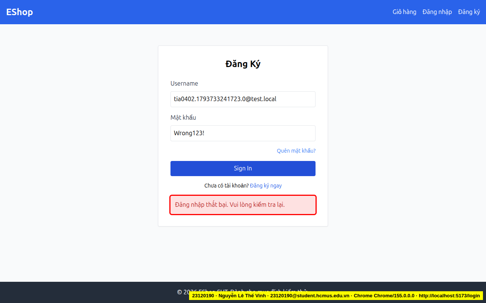

## Traceability
- Checklist item: IA-04-02 (`checklist/gui-checklist.xlsx`)
- Requirement: FR-02

---
### 37. [BUG][login] Old login error stays visible after editing the fields
Labels: type: bug, severity: trivial, priority: P3, status: new, module: login

## Mô tả lỗi
Old login error stays visible after editing the fields

## Môi trường
- OS: Ubuntu 26.04.1 LTS · Browser: Google Chrome 155.0.8059.84 (Playwright 1.64.1, headed)
- SUT: EShop `eshop-sut` commit `85af3ba` · Web http://localhost:5173 · API http://localhost:3000
- Test account: tài khoản tạo mới cho từng test qua `POST /api/register`; seed `test@eshop.com` / `Test1234!`

## Steps to reproduce
1. Đăng nhập sai để hiện banner lỗi
2. Sửa nội dung field password

## Actual result
Banner lỗi cũ vẫn hiển thị.

## Expected result
Banner cũ bị xóa khi người dùng sửa field hoặc gửi lại.

## Evidence
**IA-04-03**

## Traceability
- Checklist item: IA-04-03 (`checklist/gui-checklist.xlsx`)
- Requirement: —

---
### 38. [BUG][register] No success message after a successful registration
Labels: type: bug, severity: minor, priority: P3, status: new, module: register

## Mô tả lỗi
No success message after a successful registration

## Môi trường
- OS: Ubuntu 26.04.1 LTS · Browser: Google Chrome 155.0.8059.84 (Playwright 1.64.1, headed)
- SUT: EShop `eshop-sut` commit `85af3ba` · Web http://localhost:5173 · API http://localhost:3000
- Test account: tài khoản tạo mới cho từng test qua `POST /api/register`; seed `test@eshop.com` / `Test1234!`

## Steps to reproduce
1. Mở http://localhost:5173/register, đăng ký với password được chấp nhận

## Actual result
Chuyển thẳng sang /login, không có thông báo thành công.

## Expected result
Có thông báo "Đăng ký thành công".

## Evidence
**IA-04-04**

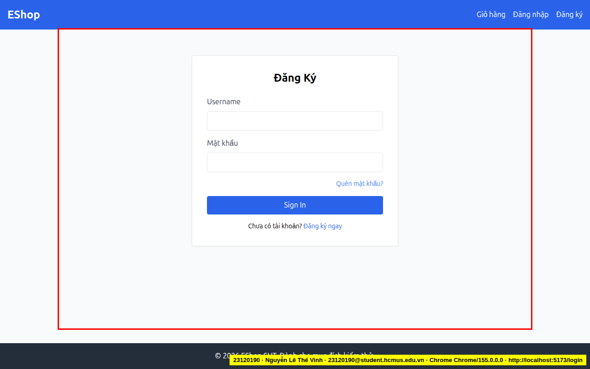

## Traceability
- Checklist item: IA-04-04 (`checklist/gui-checklist.xlsx`)
- Requirement: —

---
### 39. [BUG][profile] Empty order history has no icon/illustration
Labels: type: bug, severity: trivial, priority: P3, status: new, module: profile

## Mô tả lỗi
Empty order history has no icon/illustration

## Môi trường
- OS: Ubuntu 26.04.1 LTS · Browser: Google Chrome 155.0.8059.84 (Playwright 1.64.1, headed)
- SUT: EShop `eshop-sut` commit `85af3ba` · Web http://localhost:5173 · API http://localhost:3000
- Test account: tài khoản tạo mới cho từng test qua `POST /api/register`; seed `test@eshop.com` / `Test1234!`

## Steps to reproduce
1. Đăng nhập tài khoản chưa có đơn hàng
2. Mở /profile

## Actual result
Chỉ có text "Bạn chưa có đơn hàng nào.".

## Expected result
Empty state có icon/hình minh họa kèm message thân thiện.

## Evidence
**IA-04-13**

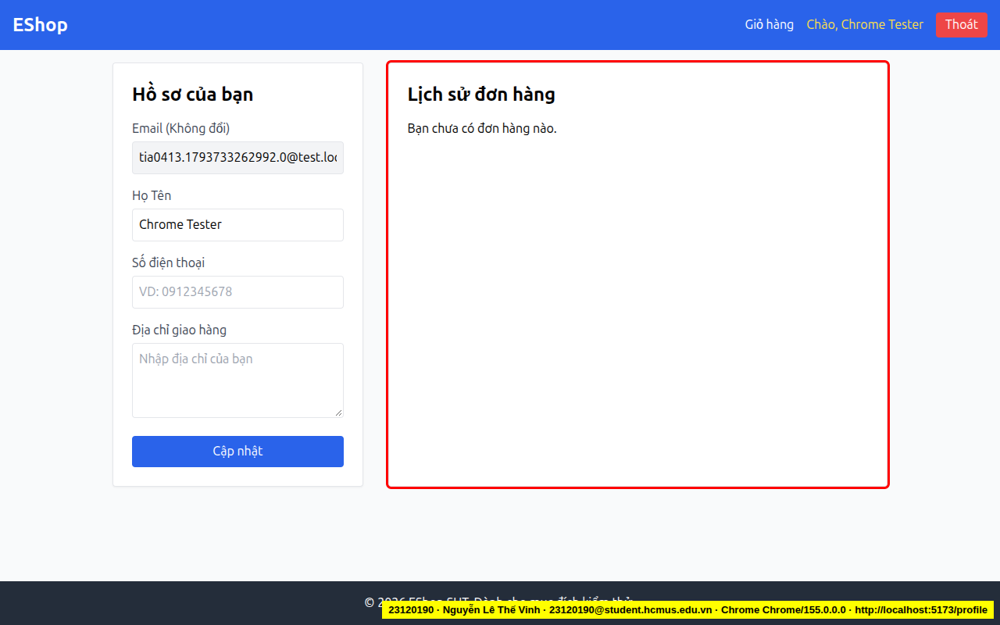

## Traceability
- Checklist item: IA-04-13 (`checklist/gui-checklist.xlsx`)
- Requirement: FR-24

---
### 40. [BUG][ui] Submit buttons have no loading state and allow duplicate requests
Labels: type: bug, severity: major, priority: P2, status: new, module: ui

## Mô tả lỗi
Submit buttons have no loading state and allow duplicate requests

## Môi trường
- OS: Ubuntu 26.04.1 LTS · Browser: Google Chrome 155.0.8059.84 (Playwright 1.64.1, headed)
- SUT: EShop `eshop-sut` commit `85af3ba` · Web http://localhost:5173 · API http://localhost:3000
- Test account: tài khoản tạo mới cho từng test qua `POST /api/register`; seed `test@eshop.com` / `Test1234!`

## Steps to reproduce
1. DevTools → Network → Slow 3G
2. Trên /login, /register, /forgot-password: bấm submit 2 lần liên tiếp

## Actual result
Nút không disable/không spinner; mỗi lần bấm gửi 1 request (2 request).

## Expected result
Nút disable hoặc hiện loading tới khi request xong; chỉ 1 request.

## Evidence
**IA-04-16**

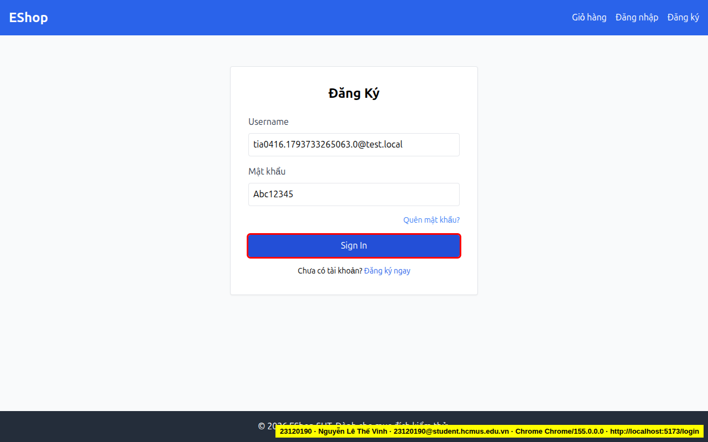

## Traceability
- Checklist item: IA-04-16 (`checklist/gui-checklist.xlsx`)
- Requirement: —

---
### 41. [BUG][ui] Feedback messages are not exposed to assistive technology
Labels: type: bug, severity: minor, priority: P3, status: new, module: ui

## Mô tả lỗi
Feedback messages are not exposed to assistive technology

## Môi trường
- OS: Ubuntu 26.04.1 LTS · Browser: Google Chrome 155.0.8059.84 (Playwright 1.64.1, headed)
- SUT: EShop `eshop-sut` commit `85af3ba` · Web http://localhost:5173 · API http://localhost:3000
- Test account: tài khoản tạo mới cho từng test qua `POST /api/register`; seed `test@eshop.com` / `Test1234!`

## Steps to reproduce
1. Gây lỗi login hoặc request OTP
2. DevTools → Accessibility, kiểm tra container thông báo

## Actual result
Container không có `role` hay `aria-live`.

## Expected result
Lỗi: `role="alert"`; thành công: `role="status"`.

## Evidence
**IA-04-17**

## Traceability
- Checklist item: IA-04-17 (`checklist/gui-checklist.xlsx`)
- Requirement: WCAG 4.1.3

---
### 42. [BUG][ui] Server failure messages are inconsistent and raw
Labels: type: bug, severity: minor, priority: P3, status: new, module: ui

## Mô tả lỗi
Server failure messages are inconsistent and raw

## Môi trường
- OS: Ubuntu 26.04.1 LTS · Browser: Google Chrome 155.0.8059.84 (Playwright 1.64.1, headed)
- SUT: EShop `eshop-sut` commit `85af3ba` · Web http://localhost:5173 · API http://localhost:3000
- Test account: tài khoản tạo mới cho từng test qua `POST /api/register`; seed `test@eshop.com` / `Test1234!`

## Steps to reproduce
1. Dừng backend hoặc trả HTTP 503
2. Submit form Login, Register, Forgot Password

## Actual result
Login báo lỗi chung như sai password; Register hiện nguyên văn "Service unavailable"; các form không nói rõ lỗi do server.

## Expected result
Thông báo thống nhất, dễ hiểu, nêu lỗi kết nối/server và cho thử lại.

## Evidence
**IA-04-18**

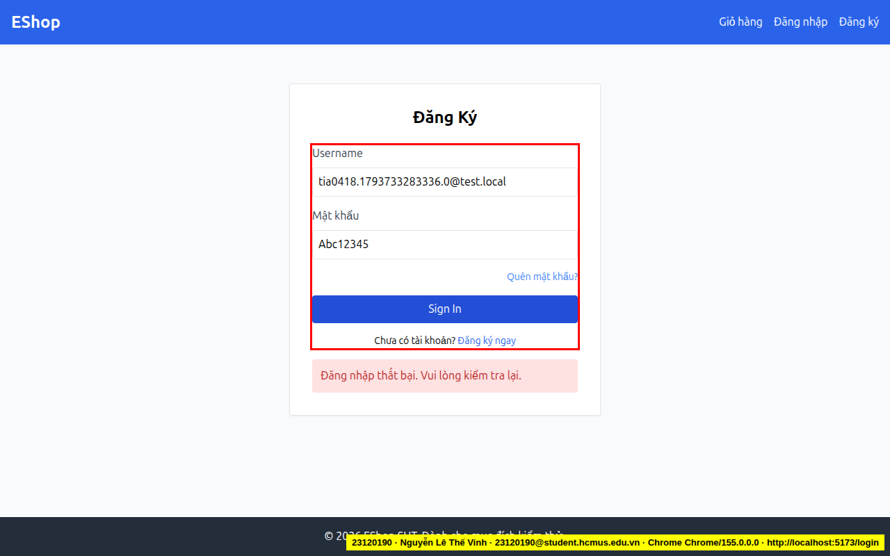

## Traceability
- Checklist item: IA-04-18 (`checklist/gui-checklist.xlsx`)
- Requirement: —
